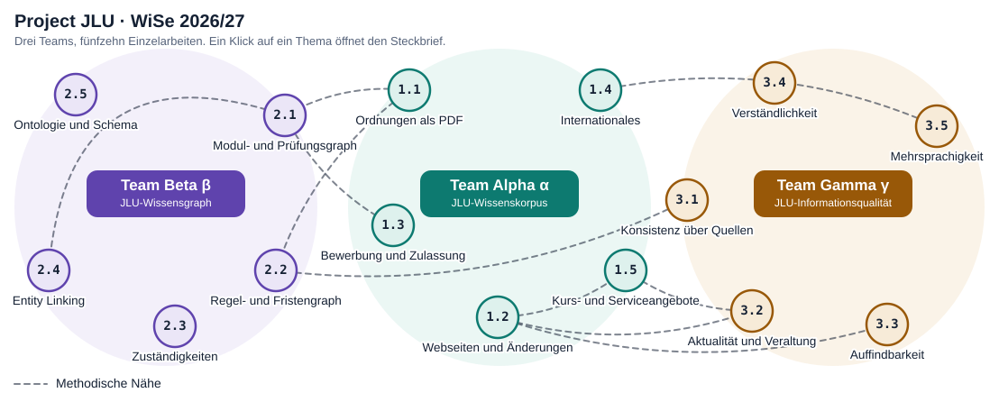

<!-- Quelle: Planungsmodul Project JLU WiSe 2026/27, Fassung v3. Stand 19.11.2026. -->

# Project JLU: Projektsteckbriefe WiSe 2026/27

Project JLU untersucht das Wissensmanagement in Studienorganisation und Verwaltung der JLU mit Methoden von Data Science und Data Analytics. Im WiSe 2026/27 arbeiten drei Teams mit je bis zu fünf Einzelarbeiten. Jede Einzelarbeit ist ein eigenes Spezialisierungsmodul mit eigenem Bericht.

## Überblick

Die Karte zeigt die drei Teams mit ihren Einzelarbeiten. Verbindungen zwischen Arbeiten bedeuten methodische Nähe: ähnliche Daten, Verfahren oder Fragen, hier lohnt sich der Austausch. Die Steckbriefe öffnen Sie über die Tabellen unten. Eine interaktive Fassung, in der jedes Thema direkt zum Steckbrief führt, liegt als [projektkarte.html](projektkarte.html) bei: Datei herunterladen und im Browser öffnen.

## Allgemeine Informationen

Vorgegeben ist das Ziel, den Weg dahin finden Sie selbst. Jeder Steckbrief nennt Fragestellung, Ausrichtung, Datengrundlage und einen Einstieg. Hypothesen, Methoden, Werkzeuge und Datenmodelle entwickeln Sie selbst und begründen Ihre Entscheidungen. Ihre Hypothesen stimmen Sie mit der Betreuung ab, bei Fragen hilft die Betreuung weiter. Eigene Ideen für die Ausrichtung sind willkommen, solange sie zur Gesamtvision von Project JLU passen.

Fest vorgegeben ist nur der gemeinsame Rahmen:

- das GitLab der JLU für Dokumentation, Code und Zusammenarbeit
- gemeinsame Termine und Besprechungsräume
- der Rahmen des Spezialisierungsmoduls: 360 Stunden, vier Monate ab dem Startdatum, Bericht nach der Vorlage des Moduls
- die ersten Aufgaben jeder Einzelarbeit: eine Literaturrecherche zum eigenen Thema, darauf aufbauend eigene Hypothesen und auf dieser Grundlage ein grober Projektplan für die vier Monate

### Werkzeugkoffer

- GitLab der JLU für Dokumentation, Code und Zusammenarbeit (Zugang siehe unten)
- auf Wunsch ein eigener Workspace als virtuelle Maschine (VM) auf dem ZAD-Cluster. Wer das nutzen möchte, meldet sich bei der Betreuung.

## Teams und Einzelarbeiten

### Team Alpha α: JLU-Wissenskorpus (Projekt Nr. 27 auf der SPZ-Plattform)

Team Alpha baut einen Korpus aus den Informationsquellen der Studienorganisation auf. Jede Person übernimmt einen Quellentyp. In den ersten drei Wochen verständigt sich das Team auf ein gemeinsames Format für die Dokumente und sichert die Quellen. Danach bearbeitet jede Person ihren Quellentyp unabhängig von den anderen Arbeiten.

| Nr. | Einzelarbeit                                                                                         | Fragestellung                                                                                                                                                          |
|-----|------------------------------------------------------------------------------------------------------|------------------------------------------------------------------------------------------------------------------------------------------------------------------------|
| 1.1 | [Ordnungen und Modulhandbücher als PDF](steckbriefe/1-1-ordnungen-pdf.md)                            | Wie lassen sich Paragraphen, Module und Tabellen aus Ordnungs-PDFs strukturtreu extrahieren, und wie lassen sich zwei Fassungen einer Ordnung automatisch vergleichen? |
| 1.2 | [Webseiten und ihre Änderungen](steckbriefe/1-2-webseiten-fb07.md)                                   | Wie lässt sich ein Webauftritt vollständig und schonend erfassen, und wie zuverlässig lassen sich inhaltliche Änderungen an früheren Fassungen der Seiten erkennen?    |
| 1.3 | [Bewerbung, Zulassung, Sprachnachweise](steckbriefe/1-3-bewerbung-zulassung.md)                      | Wie lassen sich bedingte Regeln (wer braucht welchen Nachweis bis wann) aus Fließtext- und FAQ-Seiten strukturiert erfassen?                                           |
| 1.4 | [Internationales: Erasmus, Auslandssemester, Partnerhochschulen](steckbriefe/1-4-internationales.md) | Wie vollständig deckt ein zusammengeführtes Teilkorpus die Informationsbedarfe zum Auslandssemester ab, verglichen mit den Einzelquellen?                              |
| 1.5 | [Kurs- und Serviceangebote (HRZ, ZfbK, Bibliothek)](steckbriefe/1-5-kurs-und-serviceangebote.md)     | Wie lassen sich terminierte Angebote aus Webseiten automatisch extrahieren und abgelaufene oder veraltete Einträge zuverlässig erkennen?                               |

### Team Beta β: JLU-Wissensgraph (Projekt Nr. 28 auf der SPZ-Plattform)

Team Beta modelliert das Wissen über die Studienorganisation als Graph. Jede Person übernimmt einen Teilgraphen oder ein Problem der Modellierung. In den ersten drei Wochen erarbeitet das Team aus den Dokumenten ein gemeinsames Schema: Welche Dinge und welche Beziehungen zwischen ihnen gibt es? Danach bearbeitet jede Person ihre Arbeit unabhängig von den anderen.

| Nr. | Einzelarbeit                                                                  | Fragestellung                                                                                                                                                                  |
|-----|-------------------------------------------------------------------------------|--------------------------------------------------------------------------------------------------------------------------------------------------------------------------------|
| 2.1 | [Modul- und Prüfungsgraph](steckbriefe/2-1-modulgraph.md)                     | Wie zuverlässig lassen sich Module, Leistungspunkte, Voraussetzungen und Prüfungsformen aus Modulhandbüchern extrahieren?                                                      |
| 2.2 | [Regel- und Fristengraph](steckbriefe/2-2-regelgraph.md)                      | Wie lassen sich Paragraphen, Verweise und Fristen aus Ordnungstexten als Netz abbilden, und wie tief sind die Verweisketten, denen man bis zur eigentlichen Regel folgen muss? |
| 2.3 | [Organisations- und Zuständigkeitsgraph](steckbriefe/2-3-zustaendigkeiten.md) | Welche Stelle ist für welches Anliegen zuständig, und wie lässt sich das aus Webseiten als Graph von Rollen und Stellen gewinnen?                                              |
| 2.4 | [Entity Linking und Graphqualität](steckbriefe/2-4-entity-linking.md)         | Wie lassen sich Bezeichnungen über Quellen hinweg abgleichen, und wie gut wird der zusammengeführte Graph?                                                                     |
| 2.5 | [Ontologie und Schema](steckbriefe/2-5-ontologie-schema.md)                   | Welche bestehenden Standards eignen sich als Grundlage, und wie sieht ein tragfähiges Schema für die Studienorganisation der JLU aus?                                          |

### Team Gamma γ: JLU-Informationsqualität (Projekt Nr. 29 auf der SPZ-Plattform)

Team Gamma misst die Qualität der Studieninformationen im Pilotbereich Fachbereich 07. Jede Person übernimmt eine Qualitätsdimension. In den ersten drei Wochen sichert das Team einen gemeinsamen Stand der Quellen und legt fest, welche Sachverhalte es untersucht, damit alle auf derselben Grundlage messen. Danach bearbeitet jede Person ihre Dimension unabhängig von den anderen.

| Nr. | Einzelarbeit                                                                    | Fragestellung                                                                                                                                                                       |
|-----|---------------------------------------------------------------------------------|-------------------------------------------------------------------------------------------------------------------------------------------------------------------------------------|
| 3.1 | [Konsistenz über Quellen](steckbriefe/3-1-konsistenz.md)                        | Welche Sachverhalte werden in mehreren Quellen unterschiedlich dargestellt, und wie lassen sich Abweichungen automatisch finden?                                                    |
| 3.2 | [Aktualität und Veraltung](steckbriefe/3-2-aktualitaet.md)                      | Wie alt sind die Informationen tatsächlich, und lässt sich Veraltung je Dokumenttyp vorhersagen?                                                                                    |
| 3.3 | [Auffindbarkeit und Informationsarchitektur](steckbriefe/3-3-auffindbarkeit.md) | Wie viele Schritte braucht es von den Einstiegsseiten zu einem Sachverhalt, und wo liegen Doppelungen und Sackgassen?                                                               |
| 3.4 | [Verständlichkeit](steckbriefe/3-4-verstaendlichkeit.md)                        | Wie verständlich sind Ordnungstexte, Webseiten und Informationsblätter im Vergleich, und taugen Lesbarkeitsindizes für Verwaltungstexte?                                            |
| 3.5 | [Mehrsprachigkeit](steckbriefe/3-5-mehrsprachigkeit.md)                         | Welche Studieninformationen liegen auf Englisch vor und welche nicht, und wo wäre ein englisches Angebot mit Blick auf die Internationalisierungsstrategie der JLU am sinnvollsten? |

## Ablauf bis zum Start

| Wann              | Was                                                                                                          |
|-------------------|--------------------------------------------------------------------------------------------------------------|
| Fr 20.11.2026     | Kick-off, danach einmal im GitLab anmelden und die Kennung an die Betreuung schicken                         |
| ab Mo 23.11.2026  | Zugang zum GitLab, Steckbriefe lesen                                                                         |
| bis Do 26.11.2026 | Zwei Wünsche mit Priorität 1 und Priorität 2 per Mail an die Betreuung                                       |
| Fr 27.11.2026     | Zuteilung der Einzelarbeiten und erster Jour fixe, 11:00 Uhr, online im selben Meetingraum wie beim Kick-off |
| Di 01.12.2026     | Offizielles Startdatum. Ein späterer Start ist nach Absprache möglich.                                       |

## Aufbau im GitLab

Dieses Repo verwaltet die Betreuung. Es enthält Steckbriefe, Projekt-Karte und die Protokolle der Treffen der Gesamtgruppe. Ihre Einzelarbeit führen Sie in einem eigenen Repo, das Sie selbst anlegen und verwalten. Die Betreuung laden Sie dazu ein. Wie das geht, worauf Sie achten und wie die Abgabe läuft, steht im [Leitfaden zu GitLab](gitlab-leitfaden.md).

## Zugang zum GitLab

1. Melden Sie sich einmal unter <https://gitlab.ub.uni-giessen.de> mit Ihrer HRZ-Kennung und dem zugehörigen Passwort an.
2. Schicken Sie Ihre Kennung per Mail an die Betreuung. Sie werden dann spätestens ab Mo 23.11.2026 für dieses Repo freigeschaltet und können es lesen.

Gut zu wissen: Je Person stehen in der Regel 50 Projekte mit jeweils bis zu 1 GB zur Verfügung, für große Dateien gibt es Git LFS. Die Weboberfläche ist von überall erreichbar. Zugriff per SSH funktioniert nur im Netz der Universität oder über VPN, sonst arbeiten Sie über HTTPS mit einem persönlichen Zugriffstoken.